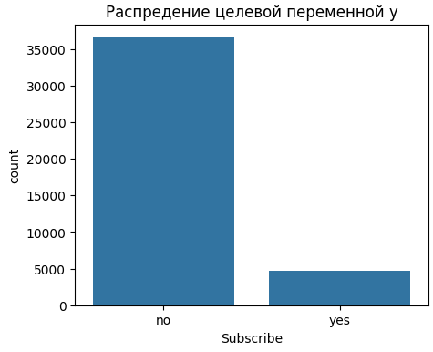
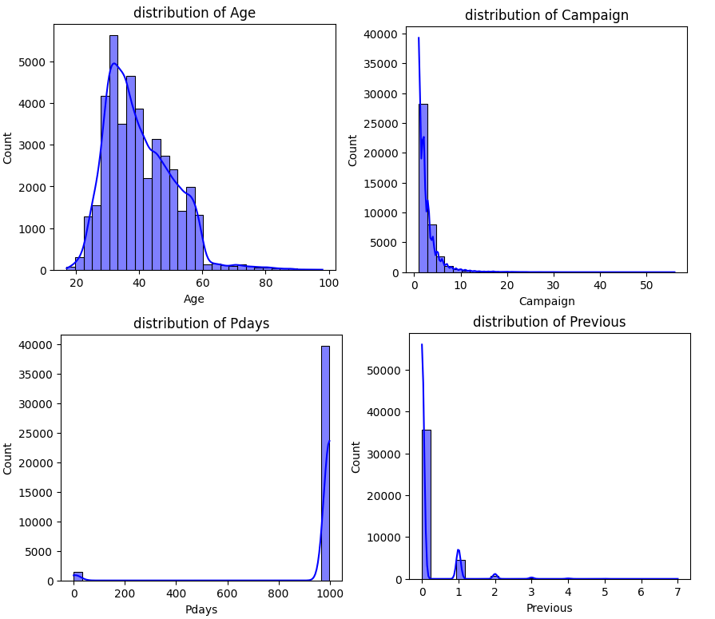
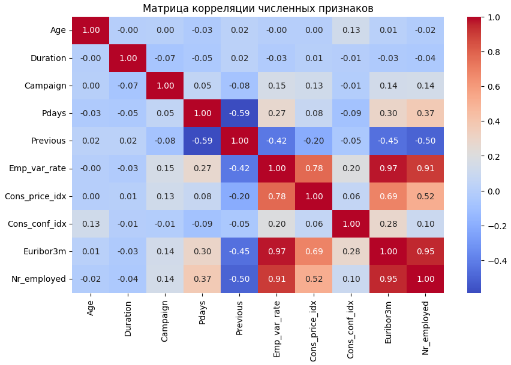

# Масликов Павел Александрович, РИМ-250921к

## Прогноз по банковским депозитам

Задачи проекта:  
1) проанализировать данные о клиентах и ​​кампаниях из маркетингового набора данных банка, чтобы выявить факторы, влияющие на оформление срочных депозитов 
2) Разработать модель машинного обучения для прогнозирования согласия клиента на депозит

## Практическая значимость проекта
Результаты анализа позволят банку перейти от массового маркетинга к таргетированному. Это оптимизирует операционные расходы на связь и повысит лояльность клиентов за счет снижения количества нежелательных звонков.
## Данные

Датасет взят с репозитория университета города Ирвайн в калифорнии (UC Irvine)
https://archive.ics.uci.edu/dataset/222/bank+marketing  

Данные относятся к кампаниям прямого маркетинга португальского банковского учреждения. Маркетинговые кампании проводились посредством телефонных звонков. Часто требовалось несколько контактов с одним и тем же клиентом, чтобы определить, согласится ли он быть оформленным на срочный банковский депозит  

Датасет содержит 41 188 строк и 21 признак (10 числовых и 11 категориальных).
Целевая переменная: y — факт согласия клиента на открытие депозита ("yes" / "no").
## Инструменты

* Pandas (обработка и очистка данных)
* NumPy (математические вычисления)
* Jupyter Notebook, Matplotlib & Seaborn (визуализация данных)
* Scikit-learn (Машинное обучение)

## Контейнеризация (Docker)
- `Dockerfile`
- Устанавливаются системные зависимости из `requirements.txt`, при выполнении докер запускает `02_Bank_Term_Deposit_Prediction2.ipynb`.

## CI/CD
- При каждом пуше `.github\workflows\ci.yml` запускает пайплайн, который запускает докер. 


## Признаки:

| Variable Name | Role | Type | Demographic | Description | Units | Missing Values |
|---|---|---|---|---|---|---|
| age | Feature | Integer | Age | | | no |
| job | Feature | Categorical | Occupation | type of job (categorical: 'admin.','blue-collar','entrepreneur','housemaid','management','retired','self-employed','services','student','technician','unemployed','unknown') | | no |
| marital | Feature | Categorical | Marital Status | marital status (categorical: 'divorced','married','single','unknown'; note: 'divorced' means divorced or widowed) | | no |
| education | Feature | Categorical | Education Level | (categorical: 'basic.4y','basic.6y','basic.9y','high.school','illiterate','professional.course','university.degree','unknown') | | no |
| default | Feature | Binary | | has credit in default? | | no |
| balance | Feature | Integer | | average yearly balance | euros | no |
| housing | Feature | Binary | | has housing loan? | | no |
| loan | Feature | Binary | | has personal loan? | | no |
| contact | Feature | Categorical | | contact communication type (categorical: 'cellular','telephone') | | yes |
| day_of_week | Feature | Date | | last contact day of the week | | no |
| duration | Feature | Integer | | last contact duration, in seconds| | no |
| campaign | Feature | Integer | | number of contacts performed during this campaign and for this client (includes last contact)| | no |
| pdays | Feature | Integer | | number of days that passed by after the client was last contacted from a previous campaign (-1 means client was not previously contacted)| | yes |
| previous | Feature | Integer | | number of contacts performed before this campaign and for this client| | no |
| poutcome | Feature | Categorical | | outcome of the previous marketing campaign (categorical: "unknown","other","failure","success")| | yes |
| emp.var.rate | Feature | Real | | employment variation rate - quarterly indicator | | no |
| cons.price.idx | Feature | Real | | consumer price index - monthly indicator | | no |
| euribor3m | Feature | Real | | euribor 3 month rate - daily indicator | | no |
| nr.employed | Feature | Real | | number of employees - quarterly indicator | | no |
| y | Target | Binary | | has the client subscribed a term deposit?| | no |


## Выходные файлы
`models_comparison.csv` - сравнение моделей  
`final_classification_report.csv` - Отчёт о классификации (Precision, Recall, F1)  
`best_svm_params.csv` - Лучшие параметры GridSearchCV  

# Анализ маркетинговых данных банка
В файле 01_Bank_Marketing_EDA.ipynb мы подробно проанализировали факторы из датасета.
Полный анализ можно увидеть в файле, здесь будут приведены ключевые диаграммы.

### Распределение ключевой переменной 



### Одномерный анализ числовых столбцов




### Анализ видов работы

| Subscribe     | no        | yes       |
|---------------|-----------|-----------|
| Job           |           |           |
| student       | 68.571429 | 31.428571 |
| retired       | 74.767442 | 25.232558 |
| unemployed    | 85.798817 | 14.201183 |
| admin.        | 87.027442 | 12.972558 |
| management    | 88.782490 | 11.217510 |
| unknown       | 88.787879 | 11.212121 |
| technician    | 89.173958 | 10.826042 |
| self-employed | 89.514426 | 10.485574 |
| housemaid     | 90.000000 | 10.000000 |
| entrepreneur  | 91.483516 | 8.516484  |
| services      | 91.861930 | 8.138070  |
| blue-collar   | 93.105684 | 6.894316  |

Наиболее распространенные категории вакансий:
- Admin
- Blue_collar
- Technician

Однако, после анализа процента подписчиков:
- Студенты (Student) показали самый высокий процент подписчиков (~31%)
- Пенсионеры (Retired) второй по величине процент подписчиков (~25%)

Вывод:  
Больше всего людей работали админами, но у студентов и пенсионеров шанс согласиться был больше всего, что делает их целевой группой.


### Анализ кредитов и финансового состояния

#### Ипотека и подписка

| Subscribe |        no |       yes |
|----------:|----------:|----------:|
|   Housing |           |           |
|       yes | 88.380608 | 11.619392 |
|        no | 89.120395 | 10.879605 |
|   unknown | 89.191919 | 10.808081 |

- У клиентов без ипотечных кредитов наблюдается чуть более высокий уровень подписки по сравнению с клиентами у которых есть ипотечные кредиты.

#### Личный кредит

| Subscribe |        no |       yes |
|----------:|----------:|----------:|
|      Loan |           |           |
|        no | 88.659794 | 11.340206 |
|       yes | 89.068502 | 10.931498 |
|   unknown | 89.191919 | 10.808081 |

- Клиенты, имеющие потребительские кредиты, реже подписываются на депозит, веротяно, потому что у них уже есть финансовые обязательства.

#### Просрочка кредита и подписка

| Subscribe |         no |       yes |
|----------:|-----------:|----------:|
|   Default |            |           |
|        no |  87.121026 | 12.878974 |
|   unknown |  94.847040 |  5.152960 |
|       yes | 100.000000 |  0.000000 |

- У клиентов с историей просрочек по кредитам практически нет подписок, в то время как у клиентов без просрочек уровень подписок выше (~12%). Это говорит о том, что финансово стабильные клиенты с большей вероятностью подпишутся на услугу.

#### Результат предыдущей маркетинговой кампании (poutcome)

|   Subscribe |        no |       yes |
|------------:|----------:|----------:|
|    Poutcome |           |           |
|     failure | 85.771402 | 14.228598 |
| nonexistent | 91.167787 |  8.832213 |
|     success | 34.887109 | 65.112891 |


- Клиенты с успешными результатами предыдущих кампаний показали самый высокий уровень подписки (~65%).
- Клиенты с неудачными предыдущими кампаниями показали значительно более низкий уровень подписки.

Вывод:

- Клиенты, ранее успешно проводившие кампании, с высокой вероятностью подпишутся снова, и им следует отдавать приоритет.


### Матрица корреляции численных значений

  
Тепловая карта показывает сильную положительную корреляцию между экономическими показателями, такими как emp_var_rate, euribor3m и nr_employed, что указывает на возможную мультиколлинеарность. Кроме того, pdays и previous демонстрируют умеренную отрицательную корреляцию (-0,59). Большинство других числовых переменных показывают слабую корреляцию, что предполагает их независимый вклад в набор данных.
Некоторые ключевые выводы, к которым мы пришли:
 Больше всего людей работали админами, но у студентов и пенсионеров шанс согласиться был больше всего, что делает их целевой группой
Клиенты с высшим образованием и средним образованием представляют собой более надежные сегменты рынка благодаря большому размеру выборки.
Клиенты с стабильным финансовым положением с большей вероятностью подпишутся на услугу.


# Рекомендации для бизнеса
На основе проведенного анализа предлагаются следующие рекомендации:
- Приоритет отдавать маркетинговым кампаниям в мобильной связи по сравнению с телефонной коммуникацией, поскольку они обеспечивают более высокую реакцию клиентов.
- Ориентироваться на студентов и пенсионеров, так как у них выше уровень подписки.
- Сосредоточиться на финансово стабильных клиентах, особенно на тех, у кого нет потребительских кредитов или истории просрочек по кредитам.
- Вернуть клиентов с успешными результатами предыдущих кампаний, поскольку они с большей вероятностью подпишутся снова.
- Стратегически планировать кампании в наиболее успешные месяцы, такие как март и декабрь, после подтверждения объема клиентов.
- Сосредоточить маркетинговые усилия на клиентах с высшим и средним образованием, поскольку они представляют собой более крупные и надежные группы клиентов.


## Заключение анализа маркетинговых данных банка

Анализ выявил несколько важных факторов, влияющих на поведение клиентов при оформлении подписки.

- Демографические данные клиентов, их финансовое положение, способы связи и результаты предыдущих кампаний играют важную роль в определении успеха подписки.
- Результаты показывают, что банк может повысить эффективность маркетинга, ориентируясь на группы клиентов с высокой конверсией, оптимизируя методы коммуникации и используя исторические данные об успехе кампаний для планирования будущих кампаний.


# Разработка модели машинного обучения

В файле 02_Bank_Term_Deposit_Prediction2.ipynb мы создавали и сравнивали несколько моделей машинного обучения для прогнозирования того, оформит ли клиент срочный банковский депозит.
Полный процесс можно увидеть в файле

## Предварительная обработка данных

- Перед разработкой модели набор данных был предварительно обработан с использованием конвейера Scikit-Learn.
- Числовые признаки были стандартизированы с помощью StandardScaler, а категориальные признаки были преобразованы с помощью OneHotEncoder.
- Целевая переменная была закодирована в виде бинарных значений.
- Признак «длительность» был исключен из моделирования во избежание утечки данных, поскольку он доступен только после завершения маркетингового звонка.


## Оценка моделей
Были протестированы и оценены следующие алгоритмы машинного обучения:

- Логистическая регрессия
- Классификатор на основе дерева решений
- Классификатор случайного леса
- Метод опорных векторов (SVM)
- Классификатор XgBOOST

Все модели обучались с использованием согласованного конвеера предварительной обработки данных для справедливого сравнения.

| Model |            Accuracy | Precision |   Recall | F1 Score |          |
|------:|--------------------:|----------:|---------:|---------:|----------|
|     3 |                 SVM |  0.852149 | 0.396941 | 0.582888 | 0.472270 |
|     0 | Logistic Regression |  0.827021 | 0.349323 | 0.607487 | 0.443577 |
|     4 |             xgboost |  0.894877 | 0.573248 | 0.288770 | 0.384068 |
|     2 |       Random Forest |  0.890629 | 0.534836 | 0.279144 | 0.366831 |
|     1 |       Decision Tree |  0.835518 | 0.289157 | 0.308021 | 0.298291 |


Поскольку набор данных сильно несбалансирован, одной лишь точности недостаточно для надежной оценки производительности. Поэтому оценка модели была сосредоточена на показателях полноты (Recall) и F1-меры.

реди всех оцененных моделей метод опорных векторов (SVM) показал наивысший показатель F1-меры (47,23%) при сохранении высокого показателя полноты (Recall) (58,29%). Это указывает на то, что SVM обеспечил наилучший баланс между выявлением потенциальных подписчиков и минимизацией неверных прогнозов.


## Основные выводы
- Точность не рассматривалась как основной показатель из-за дисбаланса классов.
- SVM показал наивысший общий баланс между точностью и полнотой.
- Логистическая регрессия показала наивысшую полноту, но более низкий общий показатель F1.
- Случайный лес и XGBOOST показали высокую точность, но не смогли идентифицировать достаточное количество реальных абонентов.
- Использование конвейеров предварительной обработки обеспечило согласованное преобразование признаков во всех моделях.


# Заключение

Методы машинного обучения успешно выявили клиентов, которые с большей вероятностью оформят срочный депозит. После сравнения пяти алгоритмов классификации метод опорных векторов (SVM) оказался наиболее эффективной моделью, достигнув наивысшего показателя F1-меры и высокой полноты (Recall).

Эта модель может помочь банку более эффективно ориентироваться на потенциальных клиентов и повышать эффективность рекламных кампаний.

## Запуск
```
docker build -t deposit-prediction .
docker run --rm deposit-prediction
```
